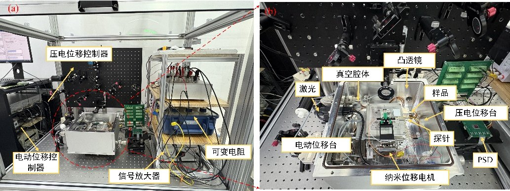
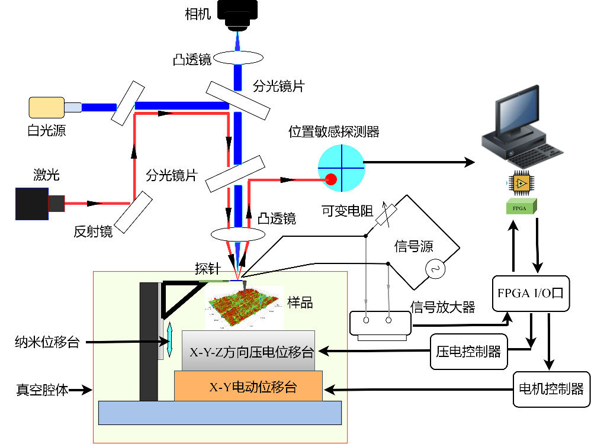
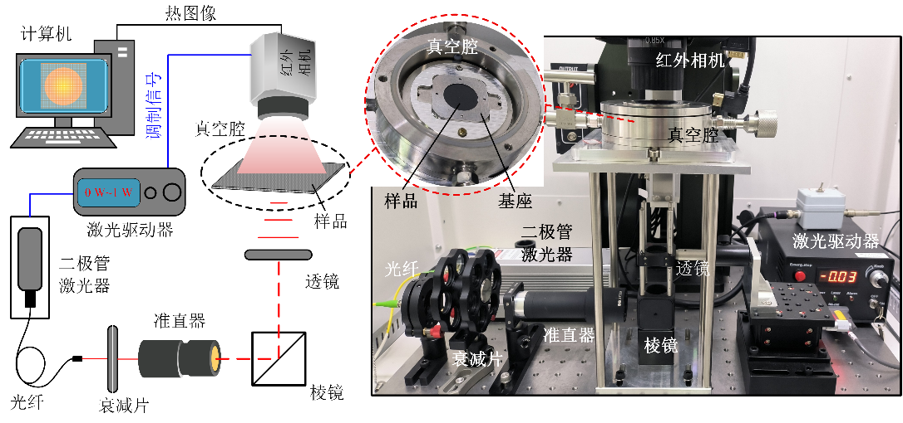
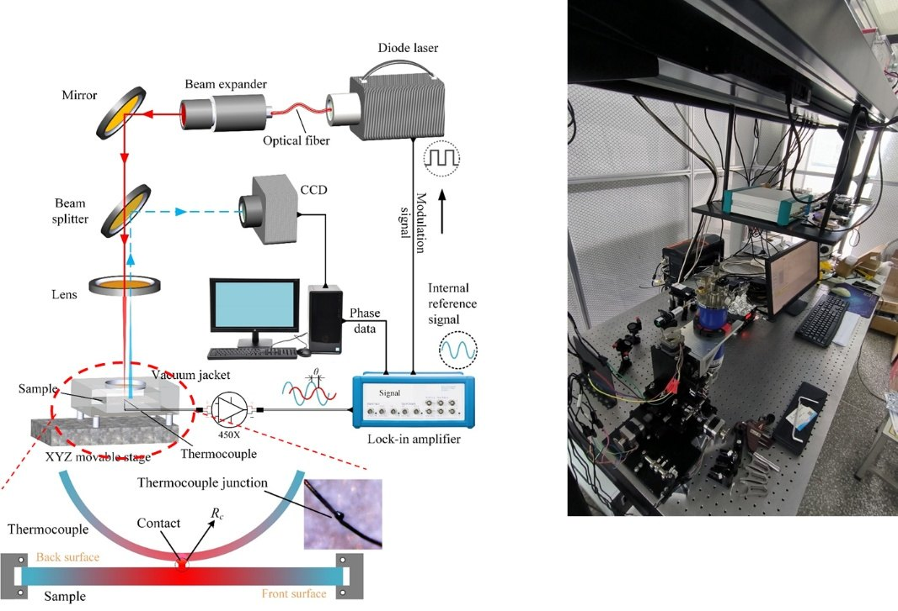
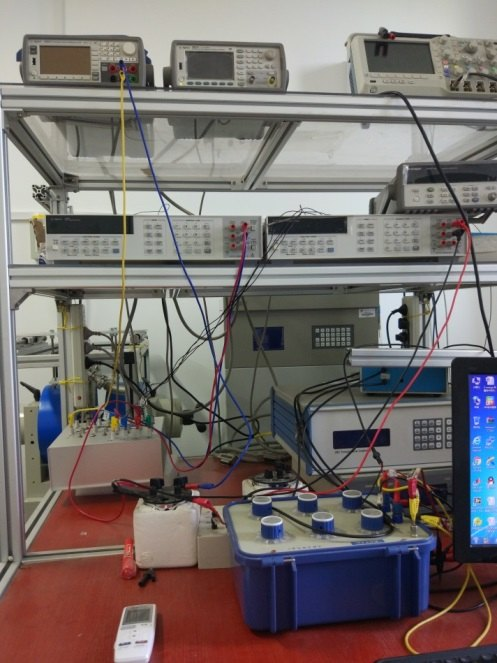
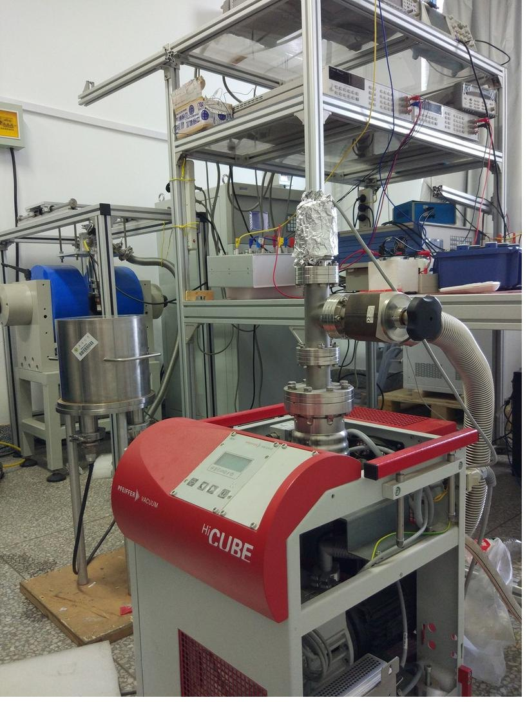
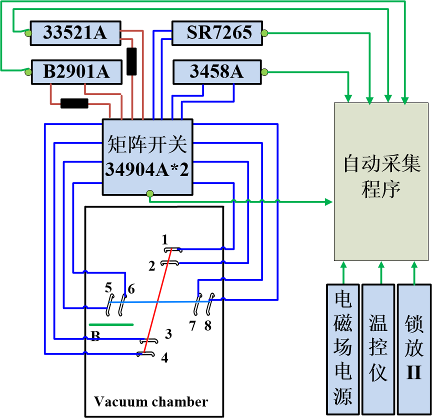
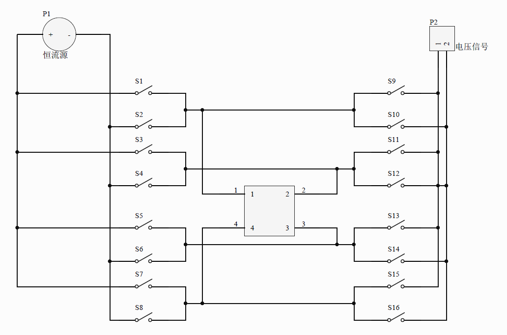
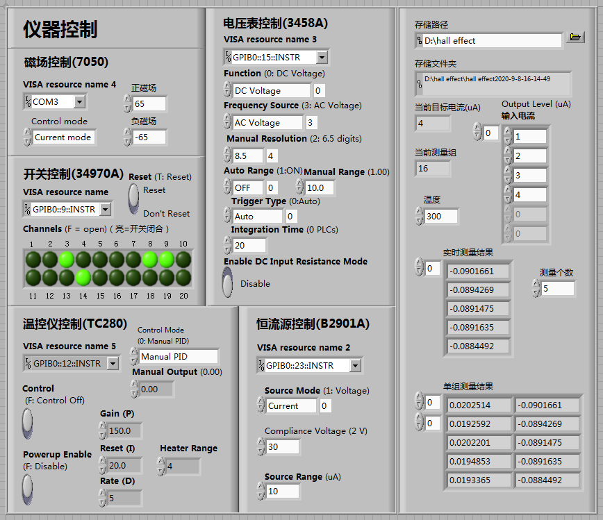

## Scanning Thermal Microscopy System

**Purpose**: Nanofabrication and nanomanipulation, as well as measurement of surface topography, nanoscale temperature, and local thermomechanical properties of materials

**Specifications**: Repeatability of 3 nm in the z direction and 50 nm in the x and y directions; travel range of 10 mm × 10 mm

**Temperature range**: Room temperature to 300 °C

## Lock-in Infrared Thermography System

**Purpose**: Measurement of three-dimensional anisotropic thermophysical properties of various free-standing thin films, and measurement of thermal contact resistance

**Specifications**: Cross-plane and in-plane thermal diffusivity range of 10⁻⁸ m²/s to 10⁻³ m²/s

**Temperature range**: 80–500 K

**Thickness range**: From the micrometer scale to 4000 μm

## Thermoelectric Property Measurement System for Micro/Nano Wires

**Purpose**: Measurement of thermoelectric properties of various fiber samples

**Sample requirements**: Diameter above 2 μm and length of approximately 5–20 mm; a cross-sectional morphology image of the sample (elliptical, flat, circular, etc.) should be provided for subsequent data processing

**Temperature range**: 80–320 K; the system can be extended up to 500 K (the extension module has not yet been purchased)

**Thermal conductivity range**: Thermal resistance per unit length of 10⁷–10¹¹ K·W⁻¹, corresponding to a thermal conductivity above 0.1 W/(m·K), preferably below 500 W/(m·K)

**Sample conductivity**: No requirement on electrical conductivity

## Other Equipment

### Hall Effect Measurement System

**Purpose**: Measurement of carrier concentration and mobility of thin films

**Specifications**: Central magnetic field of 2 T; temperature range of 80–500 K

- Infrared thermal camera
- Probe station
- Film thickness gauge
- Data logger
