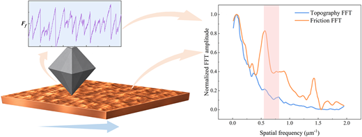

10月12日，张皓然博士的论文“Interfacial Spatial Heterogeneity-Associated Mesoscale Friction Instability at a Diamond Cu Interface”被界面力学知名期刊Langmuir接收。

论文研究了金刚石–铜滑动接触中的中尺度间歇滑动摩擦，使用了自制的摩擦学探针系统，考察了法向载荷和滑动速度对摩擦力波动的影响，并建立了特征间歇滑动重复长度与抛光铜表面统计形态之间的联系。

论文得到了国家自然科学基金52376159 和52202086的支持。

论文链接：<https://pubs.acs.org/a/5448543?guestAccessKey=f0004802-a462-49c5-91a4-a2d72475a00a>
<!-- 隐私提示：本段含带访问令牌的链接，上线前请确认是否公开 -->
