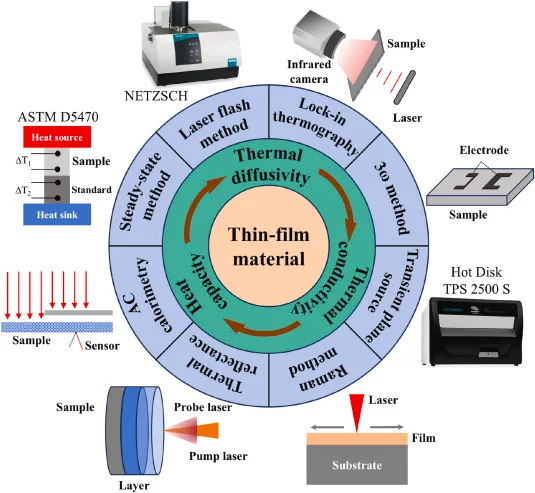

课题组受邀在Review of Materials Research  上发表薄膜测量的综述文章《Representative Methods for Measuring the Anisotropic Thermal Properties of Micro-Scale Films》，介绍了常见的几种薄膜各向异性热物性测量的方法和进展。

课题组开发的红外锁相实验系统，自2024年迄今已经发表相关论文10余篇，与多家科研院所和企业单位建立广泛合作，并参与撰写了对应的团体标准。该综述简要介绍了前期的一些工作。.

