## 1. Technical Framework and Research Platform for Intelligent Analysis and Lightweight Deployment

Long-distance oil and gas pipelines and gas field production sites are rapidly entering the digital era. Processes such as in-line pipeline inspection and wellhead pressure and production monitoring continuously generate high-frequency, high-dimensional field data, and the annual volume of minute-level pressure records for a single well has reached the order of hundreds of thousands of entries. The scale and complexity of these data make manual interpretation and experience-based analysis inadequate, while limited on-site computing power and unstable power supply and network conditions require analytical models to be as lightweight as possible and capable of real-time response. "Intelligent analysis" and "lightweight deployment" therefore constitute two complementary sides of a single technical mainline: the former addresses the problem that "there is too much data to review and it cannot be labeled accurately", while the latter addresses the problem that "the models cannot run efficiently and cannot be deployed in the field".

This research direction adopts a cascaded strategy that decouples detection from classification, splitting defect localization and type recognition into two stages, each handled by the most suitable pretrained model. In the first stage of the cascaded framework, a pretrained YOLOv5 object detection model performs rapid defect localization and candidate region extraction; in the second stage, the candidate regions are fed into a pretrained Vision Transformer (ViT) for defect type recognition. This decoupled design accommodates the practical constraints of small samples and offline training: the pretrained backbones have already learned rich texture representations from general images and can maintain stable performance even when defect-specific data are limited. Building on qualitative recognition, quantitative prediction of defect axial length and depth was further investigated. The axial, radial and circumferential magnetic flux leakage (MFL) signals are first fused channel-wise into a three-channel image and denoised, after which YOLOv8x is used for defect localization. Samples are then cropped for each defect using the largest anchor box, and the numerical features of the defect matrix are converted into image form. Together with the three-channel composite image, these six data forms in total are fed into a multi-input parallel convolutional network for training, so that the network extracts complementary features from different representational perspectives.

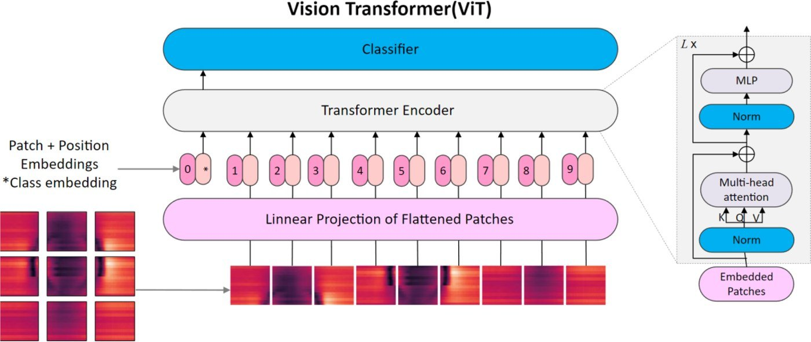

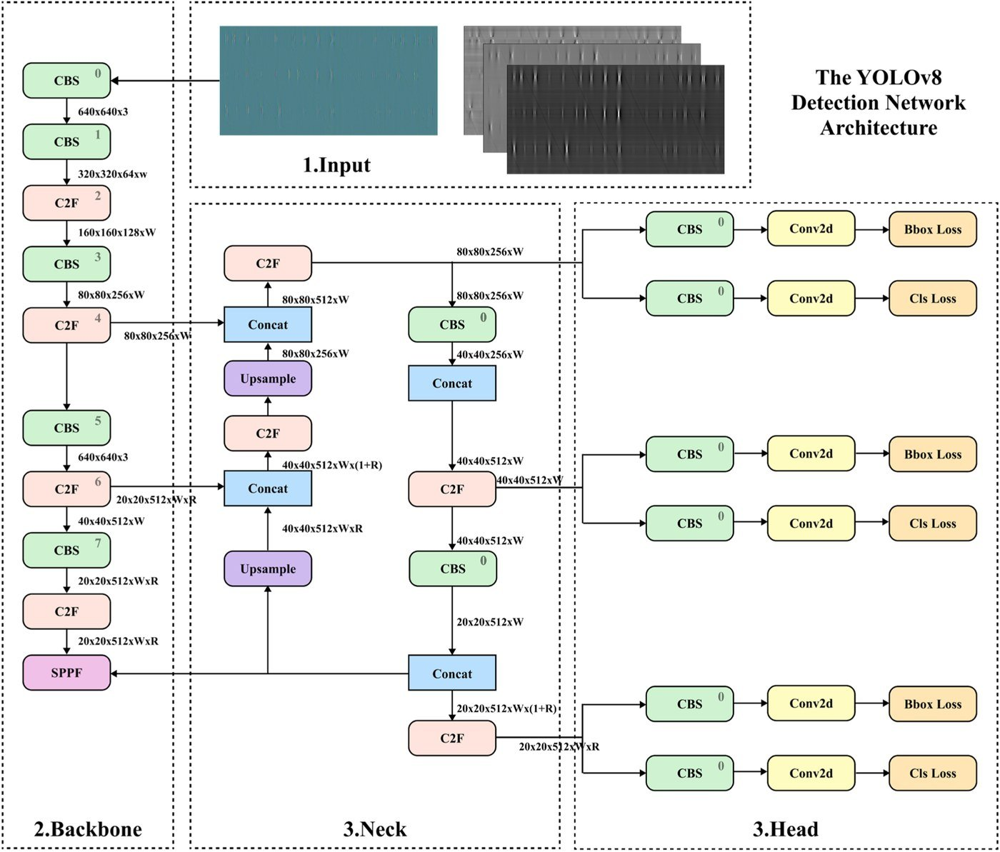
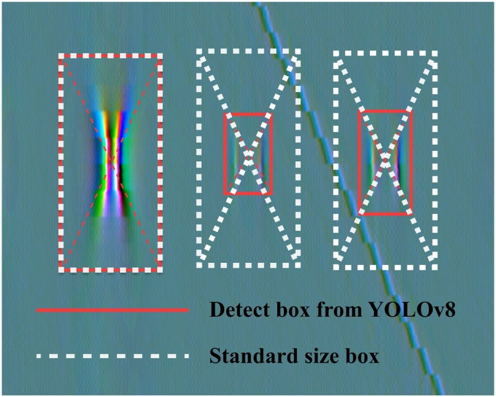

*Figure: YOLOv8 defect detection network architecture, and comparison between YOLOv8 detection boxes and standard-size boxes*

## 2. Magnetic Flux Leakage Signal Reconstruction and Generative Sample Augmentation

MFL signals are acquired in harsh environments, at high speed and over long acquisition periods, so the actual data commonly suffer from undersampling and missing channels. At the same time, real defect samples are scarce and their class distribution is highly imbalanced. These two problems correspond to the two technical routes of this research direction: signal reconstruction constrained by physical priors, and sample augmentation driven by generative models.

To address the scarcity of real defect samples and class imbalance, a class-encoded diffusion model is employed to generate MFL defect signals. The generation process is built on the denoising diffusion probabilistic model (DDPM) framework: the forward process gradually adds noise to the samples until they approximate Gaussian noise, the reverse process progressively denoises and recovers the samples using a U-Net with class embeddings, and the training objective is the mean squared error of the predicted noise. The key design is to encode the defect class into the network as control information. The simulated defects are divided into six types (cracks, pinholes, pitting, grooving, slotting and general metal loss), each with two groups of data, axial and radial, giving 12 groups in total (labeled A–L) that are input to the model as class labels. As a result, defect samples of a specified type can be generated in a targeted manner during sampling by changing the class parameter.

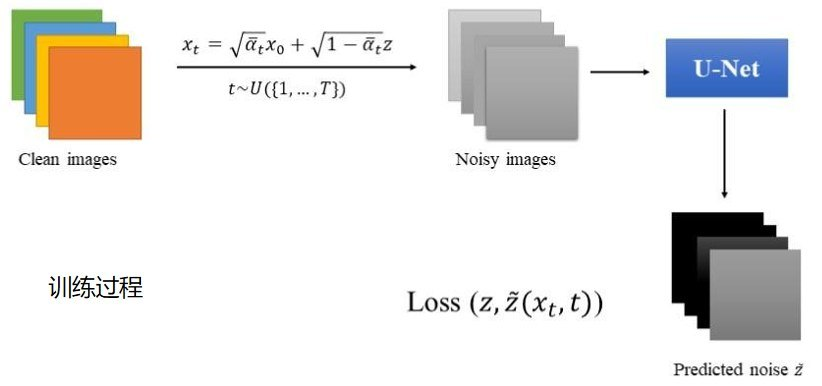
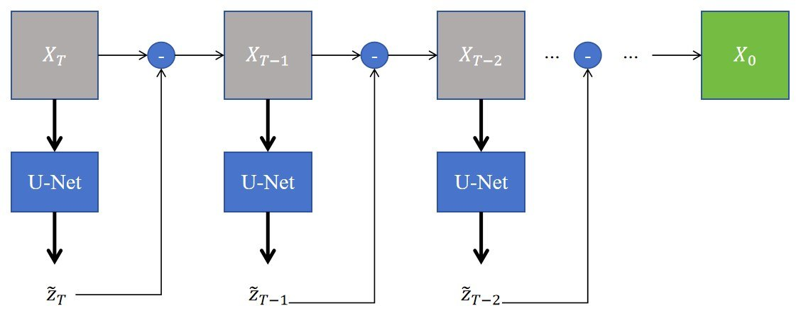

*Figure: Training process of the class-encoded diffusion model (class image → noise addition → U-Net noise prediction) and the reverse denoising sampling process*

## 3. Intelligent Prediction and Operating Condition Diagnosis for Oil and Gas Production Data

Plunger lift is an effective artificial lift method for removing liquid loading at the bottom of gas wells. A complete production cycle can be divided into stages such as liquid accumulation, lifting and unloading, and the casing pressure and tubing pressure follow different patterns in each stage. With the widespread adoption of digital plunger control systems and large-capacity databases, the massive pressure data accumulated in the field provide a foundation for machine learning, but the lack of cost-effective labeling methods has remained a limiting factor. This research direction proposes an unsupervised clustering-based diagnostic workflow that automatically segments cycles from continuous data and assigns operating condition labels.

The workflow consists of two steps. The first step is cycle point identification. In the absence of cycle point annotations, an unsupervised cycle identification algorithm based on local extremum search intervals is first developed to provide initial labels, which are then used to train a cycle identification network based on a Transformer encoder, enabling automatic localization of cycle points. The cycle points are used to segment the continuous data into periodic sub-datasets, which are assigned four labels: early liquid loading, liquid loading removal, late liquid loading and abnormal operation. The second step is dimensionality reduction and clustering. The effects of four dimensionality reduction approaches, namely statistical features, multidimensional scaling (MDS), principal component analysis (PCA) and autoencoders, on clustering quality are compared, and a CNN-LSTM autoencoder with a clustering layer is adopted to jointly optimize the reconstruction loss and the clustering loss.

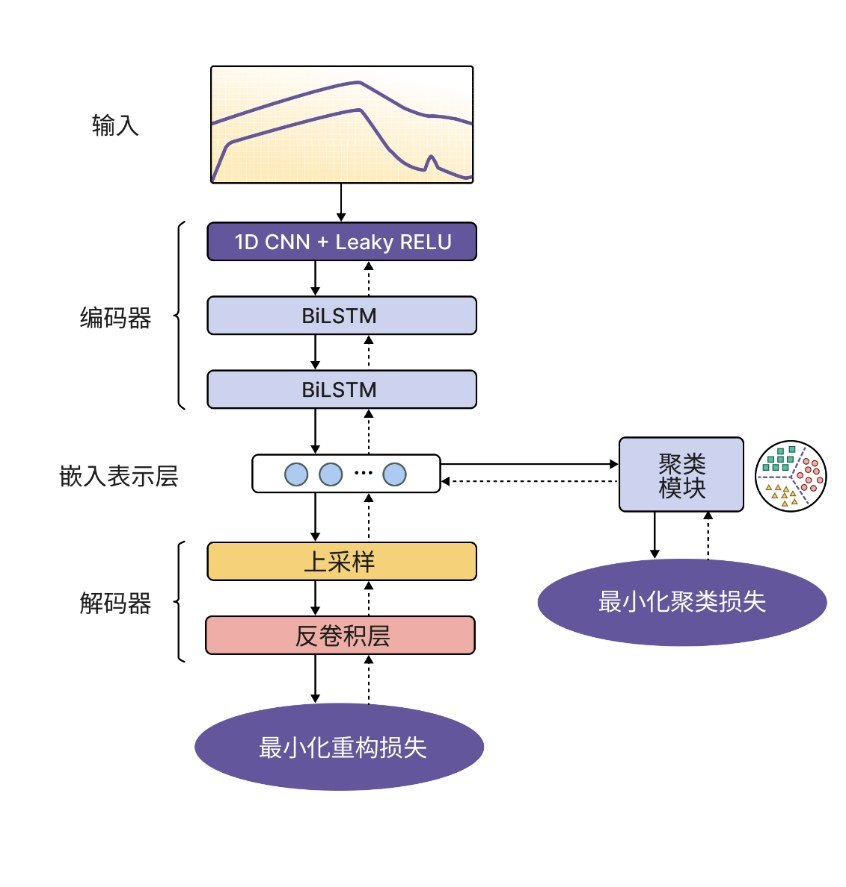
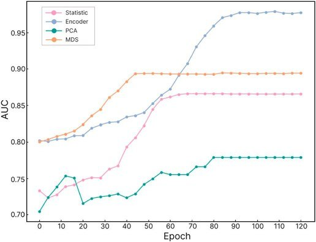

*Figure: Architecture of the CNN-LSTM autoencoder with a clustering layer, and comparison of AUC convergence curves for different dimensionality reduction methods*

## 4. Lightweight Models and Real-Time Edge Deployment

Limited on-site computing power and power budgets constitute the last mile in bringing intelligent analysis algorithms into practice. Focusing on three pathways, namely structural compression, knowledge distillation and operator optimization, this research direction compresses the aforementioned models so that they can run in real time on edge devices, and verifies the performance cost of compression through specific engineering tasks.

Phase-sensitive optical time-domain reflectometry (Φ-OTDR) is a distributed vibration sensing technology with extremely high sensitivity for pipeline safety monitoring. However, its sensitivity to the environment also causes routine activities to be misjudged as threats, leading to frequent false alarms. To make alarms actionable, continuous vibration signals must be converted into quantifiable risk levels. This research direction establishes a mapping from the distance between an excavator and the pipeline to threat levels: within 5 m is classified as "direct intrusion", within 10 m as "high-risk operation", and beyond 15 m as "background construction". On the model side, through structural optimization and parameter compression of the standard Vision Transformer, a lightweight model, LP-ViT, is proposed. It replaces standard multi-head attention with local-global hybrid attention (L-MHA), introduces relative position encoding (RPP) and a purpose-designed dual-path compression module (DPCM), and adopts multi-dimensional feature fusion and modality conversion mechanisms to suppress noise and reconstruct transient vibration features.

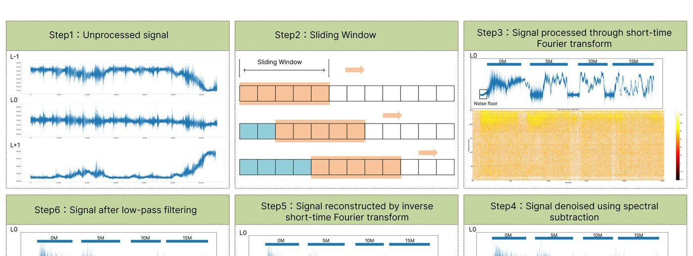
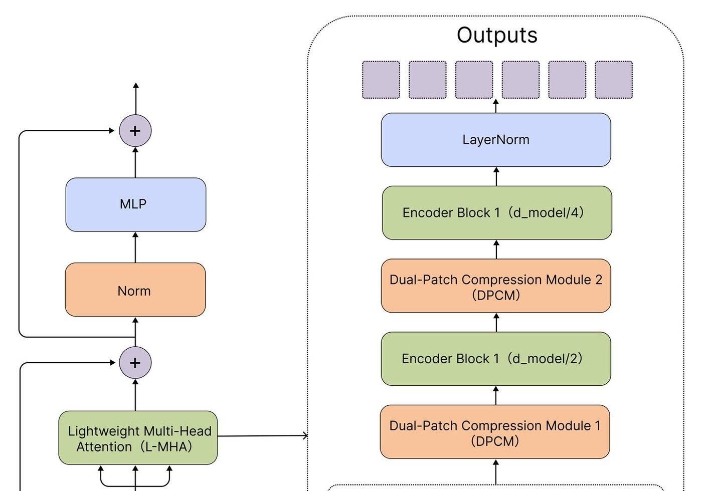
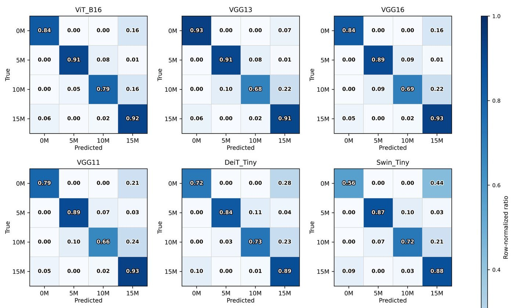

*Figure: LP-ViT lightweight network architecture (including the dual-path compression module DPCM and lightweight multi-head attention L-MHA), and comparison of confusion matrices of the models before and after compression in different scenarios*

## 5. Interactive Data Visualization and Intelligent Operation and Maintenance Platform

The results of intelligent analysis are valuable only when they are actually put to use by field personnel. Data platforms at industrial sites commonly suffer from poorly arranged functional modules, unclear information hierarchies, inaccurate visual presentation and a lack of interactivity in charts. This research direction treats visualization and interaction design as an independent research subject, forming a closed loop of "analysis algorithms, visualization platform and human-machine validation".

The platform design follows a process of information framework, design specifications, interface implementation and usability validation. At the information framework level, functional modules are integrated, core functions are deepened and information retrieval paths are optimized. At the design specification level, color, typography and icon specifications are established. At the implementation level, the platform is developed with HTML5 and JavaScript and includes a monitoring module, a daily average indicator module, a 12-hour trend module and a historical data analysis and visualization module, supporting both view interaction and event interaction.

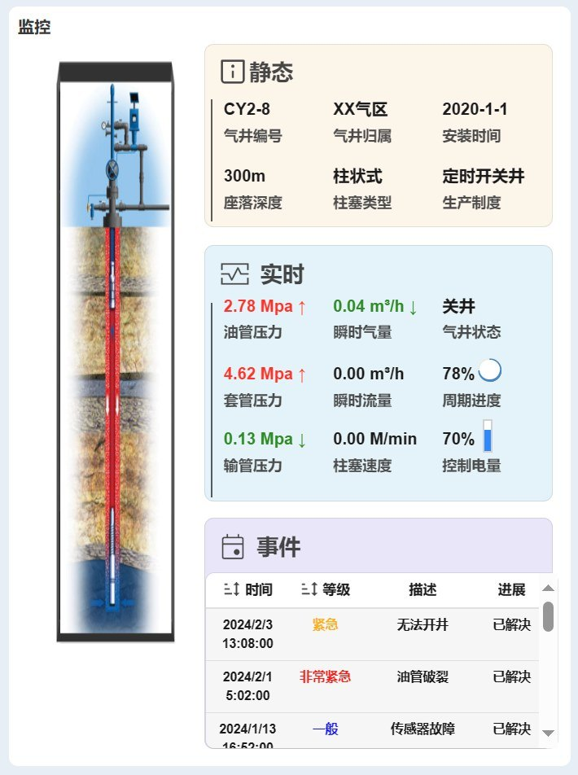
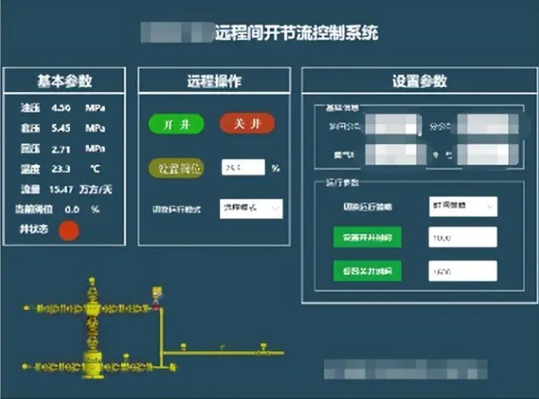
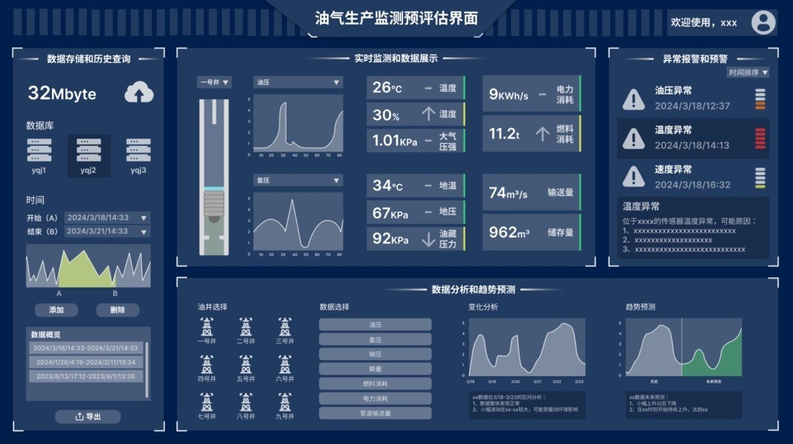

*Figure: Oil and gas production data monitoring and pre-assessment interface*
