## 一、测量微米薄膜各向异性热物性

独立微米薄膜，例如石墨烯均热膜、聚酰亚胺薄膜等，被广泛应用到新能源、芯片散热等领域，掌握其各向异性热输运性质至关重要。随着薄膜厚度减少到了微米量级，表面形貌、导电性等都存在巨大差异，表征这些材料的热输运性质成为了重大挑战。目前业内基本都采用商用化的激光闪光分析仪 （LFA）进行薄膜热输运性质表征。但是当薄膜厚度降低到微米级，无论是面内（薄膜表面方向）还是面外（薄膜厚度方向）热输运性质，LFA测量数据的可靠性都被广泛质疑。

针对各向异性微米薄膜热测量的巨大应用需求，课题组开发了一种基于激光周期加热的测试系统，用于测量微米薄膜的各向异性热扩散率和热导率。有别于LFA和锁相红外技术，该测试方法将相位的空间分布分为线性和非线性区域，分别采用一维和三维热传导模型测量得到微米薄膜的面内和面外热扩散率。目前测试结果表明，该系统测试范围涵盖热扩散率：1×10⁻⁸ m²/s到1×10⁻³ m²/s，厚度：微米到毫米，温度：80K到500K。目前，通过与浙江大学、宁波材料所等国内诸多单位合作，该系统已经成功测量了包括石墨烯均热膜、聚酰亚胺薄膜、木制纤维薄膜等多种各向异性薄膜，对薄膜材料研发具有重要意义。

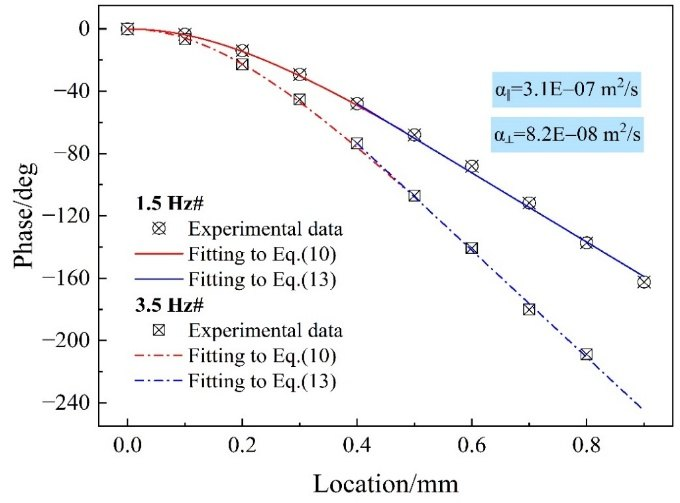
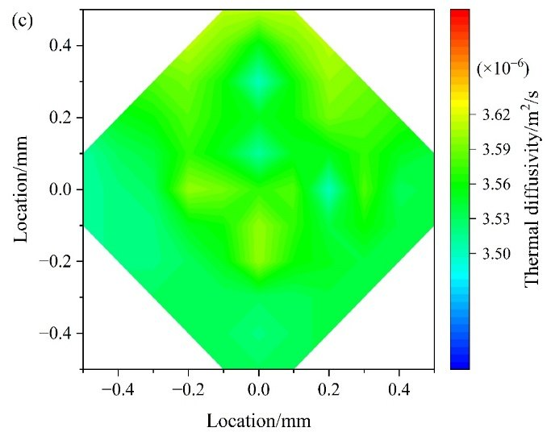
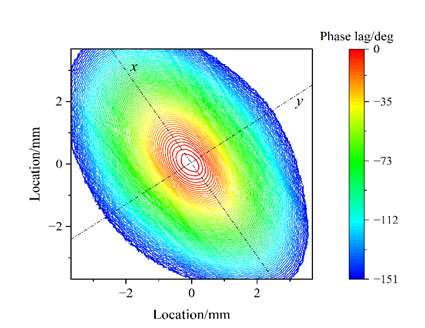
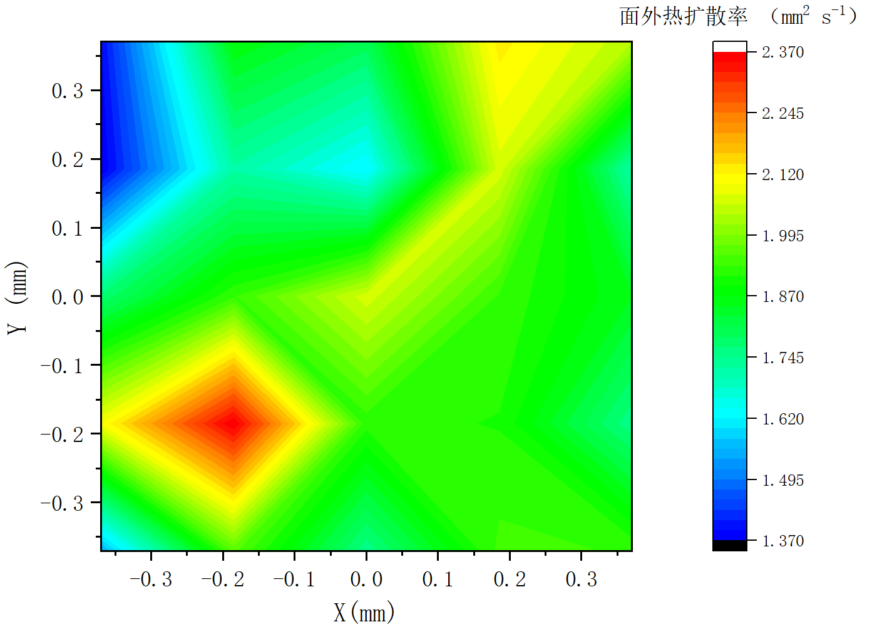
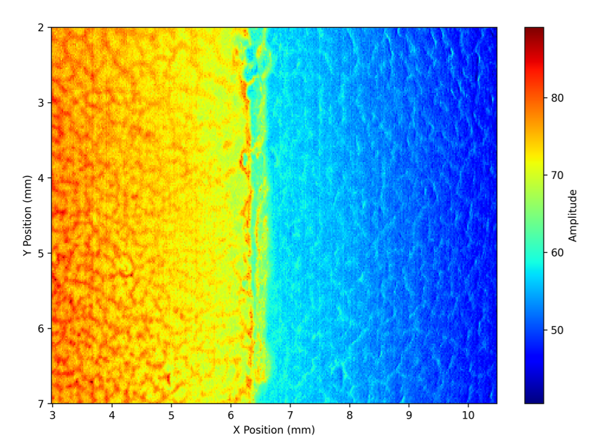
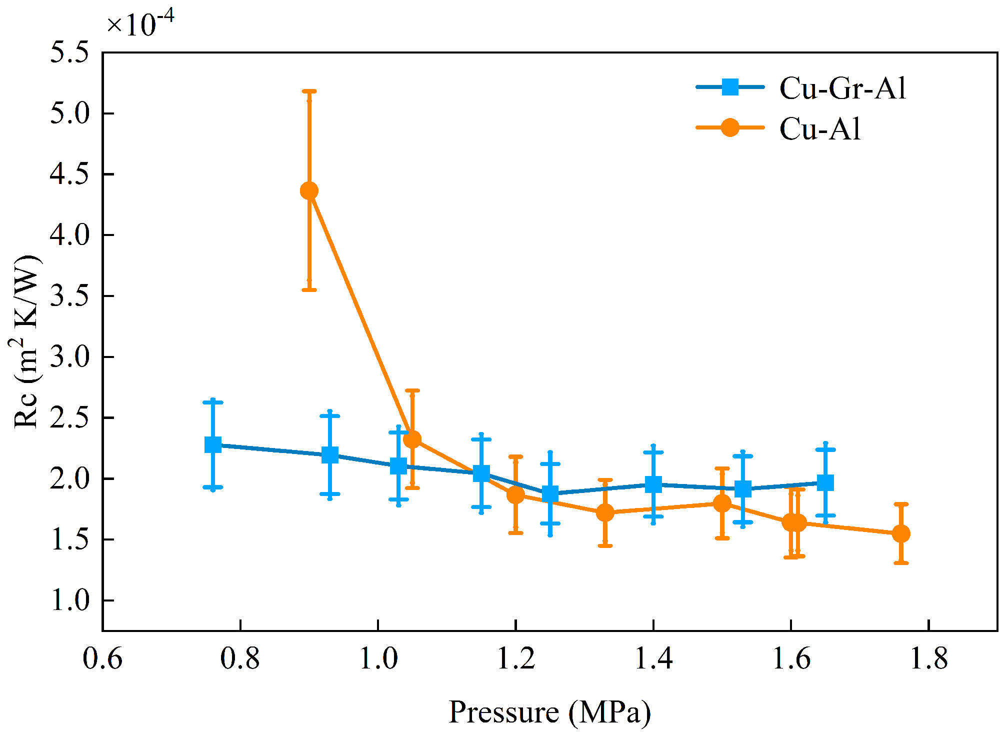

*图：微米薄膜各向异性热物性和接触热阻测量*

## 二、测量微纳米结构热电性质与接触过程

设计加工了用于纳米线热电性质测量的微器件，解决了金属纳米线自加热测量过程中纳米线操作、电脉冲、机械振动、焊点加工等一系列技术难题。测量得到了金属纳米线与电极间的接触电阻，并定量分析了接触电阻对金属纳米线热导率测量的影响规律，证明了Wiedemann-Franz定律仍然适用于单晶金属纳米线。通过单晶Ag纳米线在电子辐射前后的对比实验, 发现即使在低能电子辐射下纳米线电导率仍将显著减小，并在透射电镜下原位观测得到缺陷的迁移过程，揭示了电导率降低的内在机理。在消除接触电阻对热电性质测量影响的前提下，进而实现了单根多晶Pt纳米线热电性质测量，得到了Pt纳米线随直径以及温度变化的理论预测模型。通过比较纳米多孔金在热处理前（单晶结构）后（多晶结构）热电性质的差异，进一步明确了纳米晶界对热电输运的不同作用。

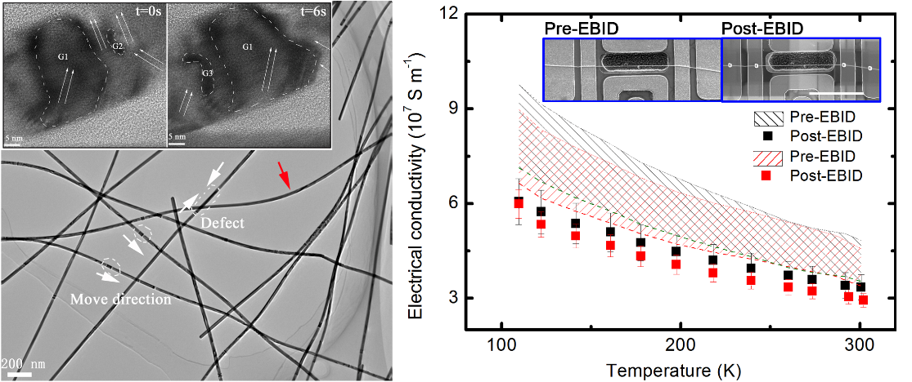
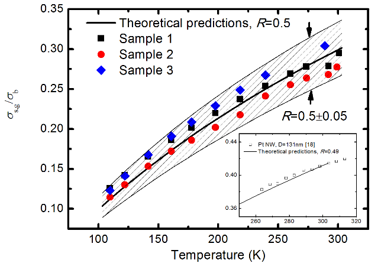
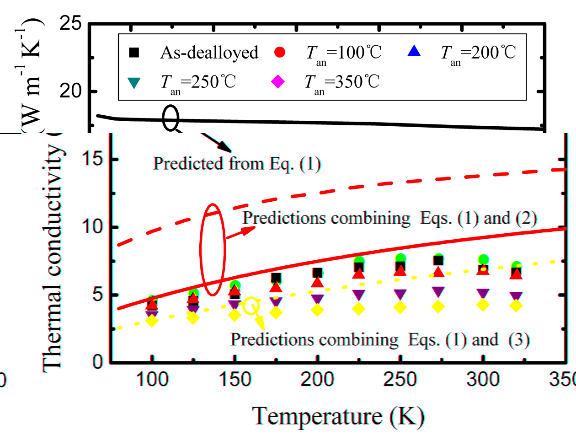

*图：金属纳米线热电性质测量*

为了进一步研究纳米尺度接触的热输运性质及其影响规律。开发了交叉微纳米线结构，搭建了测量两根交叉微米线间接触热阻和接触电阻的实验系统，采用通电加热法将微米线加热至近熔融状态，从而消除了表面非导电层的影响，设计并制作了用于微弱电流信号测量的前置放大电路，实现了真空环境下两根交叉微米线接触电阻和接触热阻的原位调控与同时测量。通过接触电阻随温度的变化趋势区分了接触电阻中麦克斯韦电阻和Sharvin电阻的不同贡献，并证明了Wiedemann-Franz定律对金属接触处于弹道/扩散输运过程仍然适用。

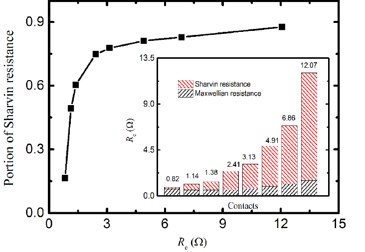
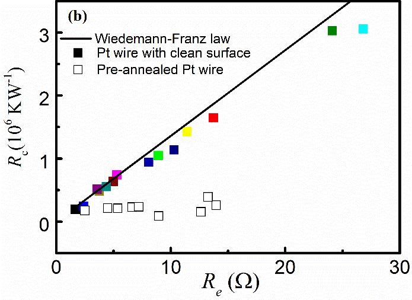

*图：金属纳米接触热电性质测量*

在低温真空环境下引入磁场调控，在磁场中通过安培力作用，实现了交叉微米线中待测线和加热线的原位搭接和分离。通过在加热线中通交流电，测量得到待测线与加热线间的接触热阻，结合稳态方法，同时得到待测线的热导率和热扩散率。采用以上的交叉微米线结构和实验系统，在准确评估待测线与加热线间接触热阻的基础上，测量了导电、非导电微米线材料的热导率和热扩散率。结果表明，虽然通过安培力可以随机改变待测样品与加热线间的接触热阻，对应不同接触热阻可能相差数十倍，但测量得到的样品热导率和热扩散率保持不变；在相同搭接条件下，采用不同测试方法的结果可以相互验证，这些都保证了测量结果的可靠性。目前，该套系统已经服务于昆明物理所、航天5院、山西煤化所等多家单位。

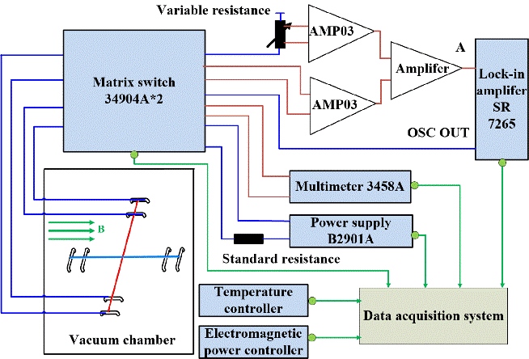
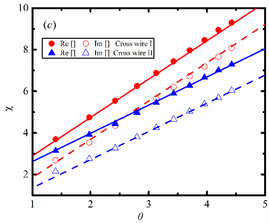

*图：微米线热电性质测量*

最近，课题组又在以上系统基础上进行了拓展，应用于聚合物微米薄膜热导率的直接测量。在相同的实验环境下，通过比较与待测聚合物薄膜搭接前后加热线两端的三倍频电压，获得聚合物薄膜引入的热阻抗。理论和实验研究表明，该热阻抗随对数频率增加而线性下降，对应的斜率与聚合物薄膜面内热导率呈反比。不同于闪光法、飞秒激光热反射法、光热法等其他方法，该方法对聚合物薄膜样品的表面粗糙度不敏感，也可用于测量透明薄膜样品，在接触热阻、接触尺寸未知条件下直接获得薄膜面内热导率。

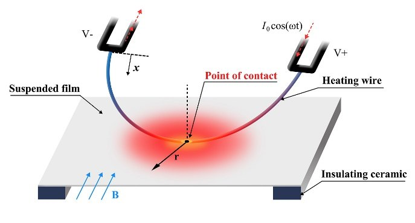
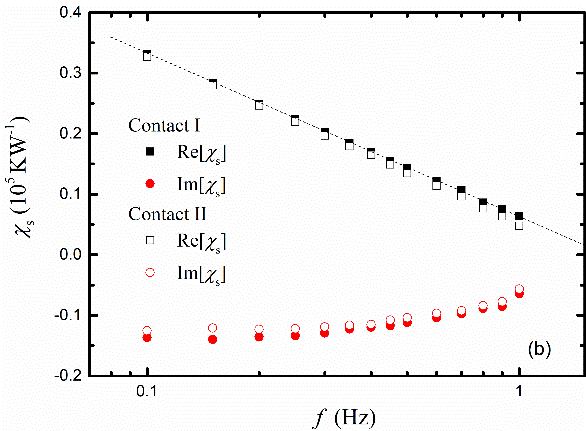

*图：微米薄膜热导率直接测量*

## 三、基于T形热探针的扫描热显微镜系统研发

扫描热显微镜是目前可用于100 nm以下微结构热电输运性质研究少数可行的实验方案之一，但是热探针设计和制备难度大，成本高，且损耗大，极大限制了扫描热显微镜的推广和应用。课题组借鉴Wollaston探针，在T形结构的基础上开发新型热电阻探针，搭建扫描热显微镜实验系统。目前，该系统已经用于大深宽比表面结构（AR>1）的三维形貌测量。与普通商用硅探针相比，T形热探针制备简单，可以重复利用，大幅度降低了扫描热显微镜系统的开发成本。

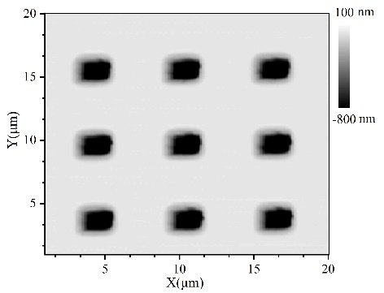
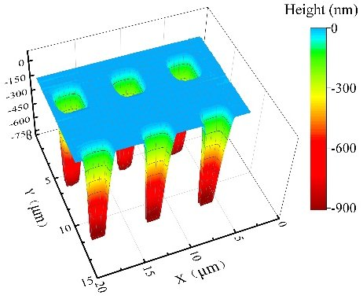
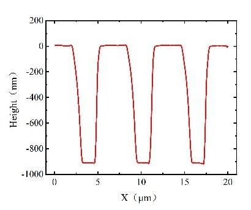
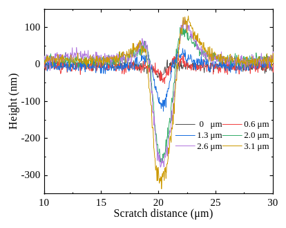
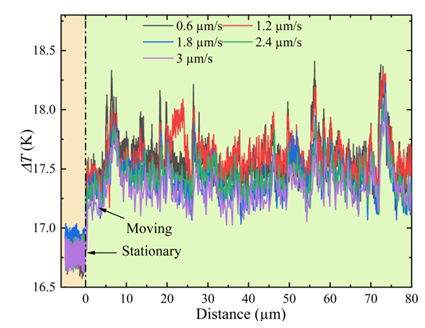

*图：表面形貌、微纳米加工以及接触热、力参数测量*

## 四、测量和调控半导体纳米薄膜的超快能量传递过程

课题组采用放大级飞秒激光热反射技术，利用脉冲整形器生成双脉冲泵浦光，通过改变双脉冲的间隔时间，在不改变泵浦光能量密度的前提下，实现了相干光学声子的增强和完全消除，进而用实验直接证明了相干光学声子能够提高半导体超快能量转换效率。建立了电子吸收、能带填充和电子-空穴湮没等三个过程与单晶Bi₂Te₃半导体薄膜反射信号之间的理论模型，其中非零背景信号源于电子-空穴湮没过程，且随着脉冲强度增加而增大；用双温度模型很好预测半导体内部电子在导带内跃迁的弛豫过程；而能带填充和电子吸收两个过程相互作用，导致反射信号呈现不同正负号，进而揭示了反射信号随脉冲强度变化的内在机理。

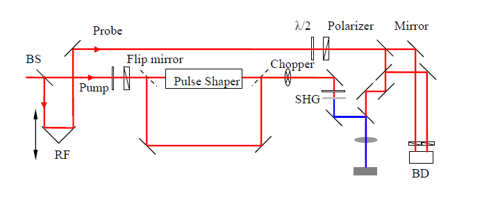
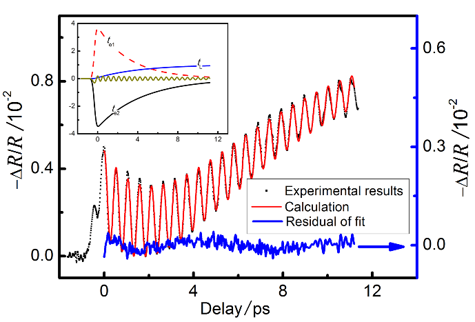
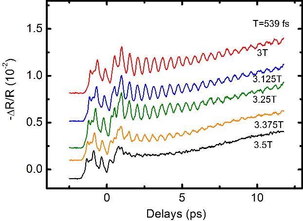

*图：半导体薄膜超快能量传递过程测量*
