## 1. Intelligent Optimization Design Methods and Platform for Thermal Equipment

Thermal equipment such as heat exchangers and heat sinks is widely used in energy and power engineering, electronics cooling, and oil and gas extraction, and its performance directly determines the energy efficiency and operational safety of the entire system. In conventional design workflows, structural selection, parameter specification and performance verification are carried out in isolation from one another, and the relationships between design variables and optimization objectives are often highly nonlinear or even non-convex. Because design has long relied on empirical trial and error, it is difficult to obtain a globally optimal solution within a limited development cycle. To address this problem, our group established an integrated intelligent optimization platform for thermal equipment that covers the full chain of "parametric structural modeling, automatic meshing, numerical solution, post-processing and intelligent optimization". Intelligent algorithms such as the genetic algorithm (GA) and Bayesian optimization (BO) are coupled with commercial CFD/CAE software through secondary development, enabling the optimizer to search the design space iteratively and automatically without manual intervention, and achieving fully automated optimization from geometry to performance.

To meet the cooling demands of high-power-density electronic devices (heat flux of approximately 300 W/cm²), a cross-cut heat sink with sinusoidal wavy fins was taken as the research object. A Bayesian optimization algorithm was used to automatically adjust three structural parameters, namely fin period, amplitude and phase shift angle, with the thermal performance factor (TPF), which balances heat transfer capability against the pressure drop penalty, as the objective function. After optimization, the TPF of the heat sink increased by 17.6%, and the synergy angle between the pressure gradient and the velocity decreased by approximately 6.2°. The root-mean-square error of the Gaussian process surrogate model dropped rapidly within the first several iterations and then stabilized, and the optimal structure was reached after only 39 iterations, at a computational cost significantly lower than that of commonly used evolutionary algorithms. This provides an efficient tool for optimal design in large-scale simulation scenarios.

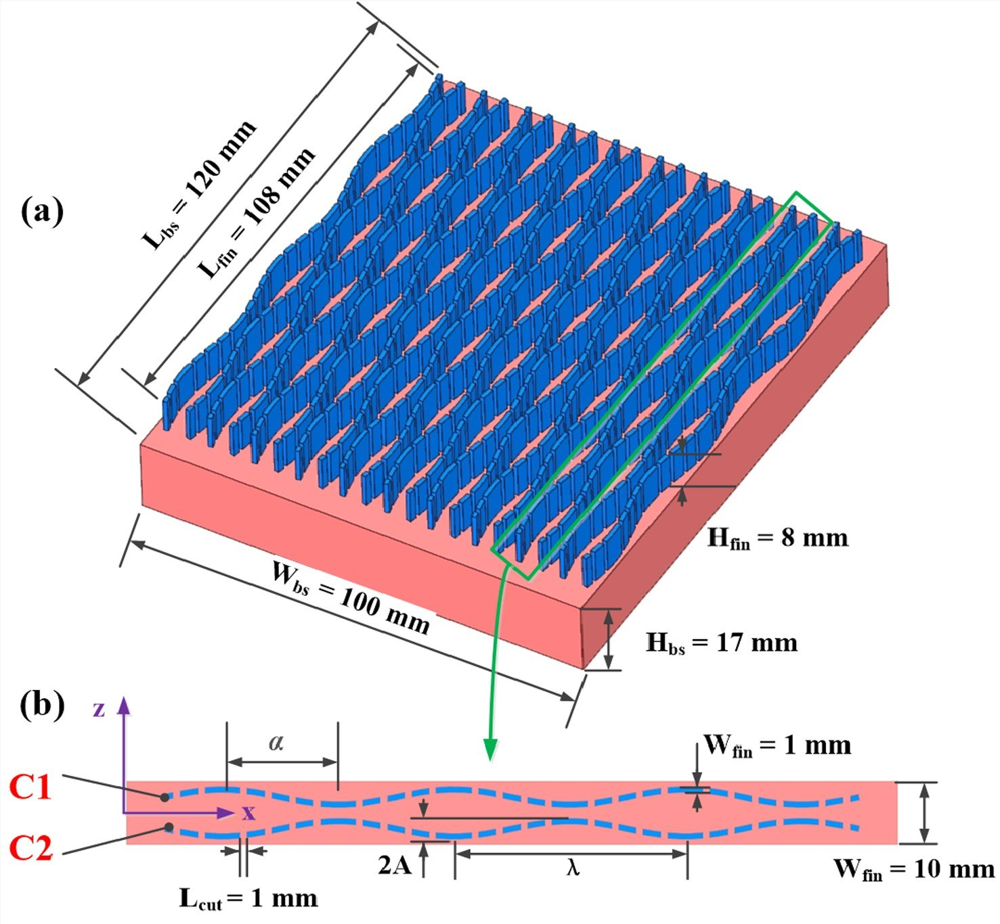
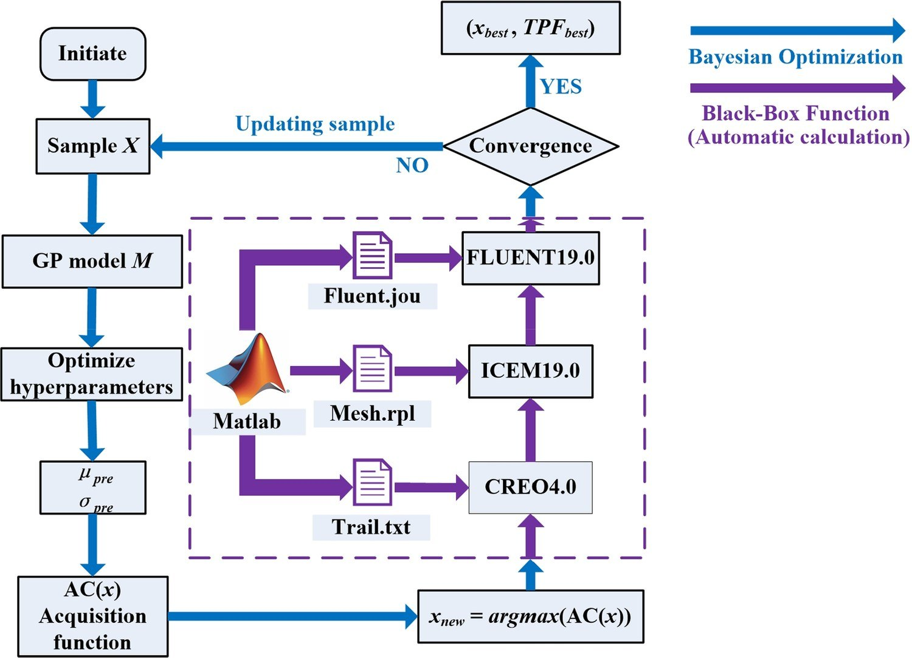

*Figure: Structure of the cross-cut heat sink with sinusoidal wavy fins (left) and the automated Bayesian optimization-CFD workflow (right)*

## 2. Multi-Objective Collaborative Optimization Design of Liquid-Cooling Equipment

Power batteries and energy storage systems generate large amounts of heat during charging and discharging. Excessive temperatures or non-uniform temperature distributions accelerate capacity fade and may even trigger thermal runaway, and liquid cold plates are currently among the most effective cooling solutions. Improving cooling efficiency while reducing pumping energy consumption is the central trade-off in liquid-cooling system design. Taking a serpentine-channel water-cooled plate as the research object, our group established an integrated automatic optimization platform covering "geometry, meshing, solution and optimization": automatic parametric geometry modeling is implemented in SpaceClaim, automatic meshing in Fluent-Meshing and automatic solution in Fluent-Solution. The entire CFD workflow is then encapsulated as a black-box function on a Python development platform and coupled with the optimization algorithm in a closed loop, achieving automatic mapping between design variables and objective values.

A multi-objective Bayesian optimization algorithm was employed to optimize the channel width, depth and bend radius, with the maximum battery module temperature Tmax and the cold plate pumping power PP as the optimization objectives. Sensitivity analysis shows that channel depth has a significant effect on Tmax, whereas channel width and bend radius mainly affect PP. On this basis, a Pareto front was constructed, and K-means clustering was used to extract four representative designs with different performance orientations from the front, providing multiple candidate solutions for engineering selection. Compared with the initial design, the optimal design slightly reduces the maximum module temperature while reducing the pumping power by 71%, achieving a synergistic improvement in thermal reliability and operating energy consumption. To evaluate the temperature uniformity within the cells, a heat-flux-weighted average temperature metric was introduced. Its trend is consistent with that of Tmax, indicating that reducing Tmax favors a more uniform cell temperature distribution, which simplifies the trade-off between thermal management and energy consumption.

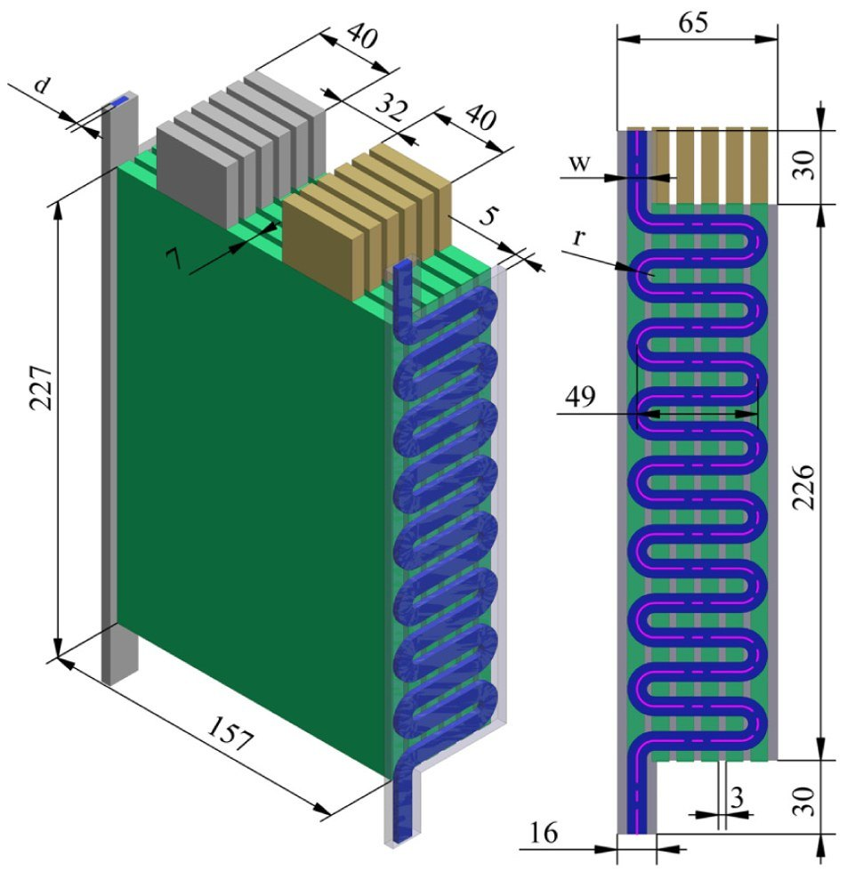
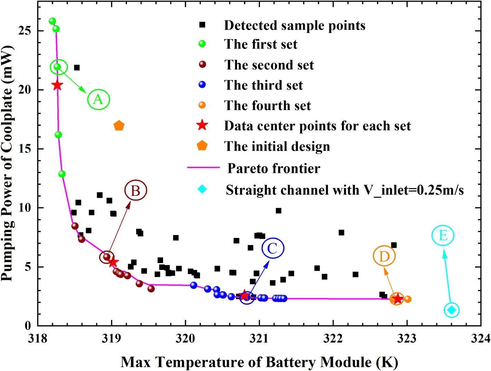

*Figure: Pareto front of the maximum battery module temperature versus cold plate pumping power, and representative designs*

## 3. Vapor-Liquid Two-Phase Transport Mechanisms and Performance Regulation of Flat Micro Heat Pipes

Flat micro heat pipes achieve efficient heat transfer through internal vapor-liquid phase change and two-phase circulating flow. Offering high effective thermal conductivity, small volume and light weight, they are an ideal solution for thermal management in confined spaces. For flat micro heat pipes with a composite wick of copper foam and spiral woven mesh, our group established a three-dimensional transient numerical model, using the volume of fluid (VOF) method to simulate the vapor-liquid phase change and circulating flow inside the heat pipe. Unsaturated flow effects of porous media were introduced into the composite wick domain, significantly improving the accuracy of numerical simulations at high heat flux. The simulation results agree well with the experimental data, with a maximum relative uncertainty of approximately 1.03%.

Based on this model, the heat transfer performance of flat micro heat pipes was systematically investigated under different heat fluxes, inclination angles and cooling conditions. The results show that under all operating conditions, the wall temperature of the heat pipe reaches steady state within 30 s, indicating a rapid thermal response. Compared with horizontal placement, the total thermal resistance at an inclination angle of 30° is reduced by about 16%, indicating that gravity can effectively accelerate the internal vapor-liquid circulation and enhance two-phase heat transfer. The optimal filling ratio is approximately 150%, and the heat pipe maintains good heat transfer capability even under anti-gravity conditions, demonstrating excellent anti-gravity performance. These results provide a reference for selecting the working environment, installation orientation and cooling conditions of flat micro heat pipes, and lay a foundation for their application in the thermal management of high-heat-flux electronic devices.

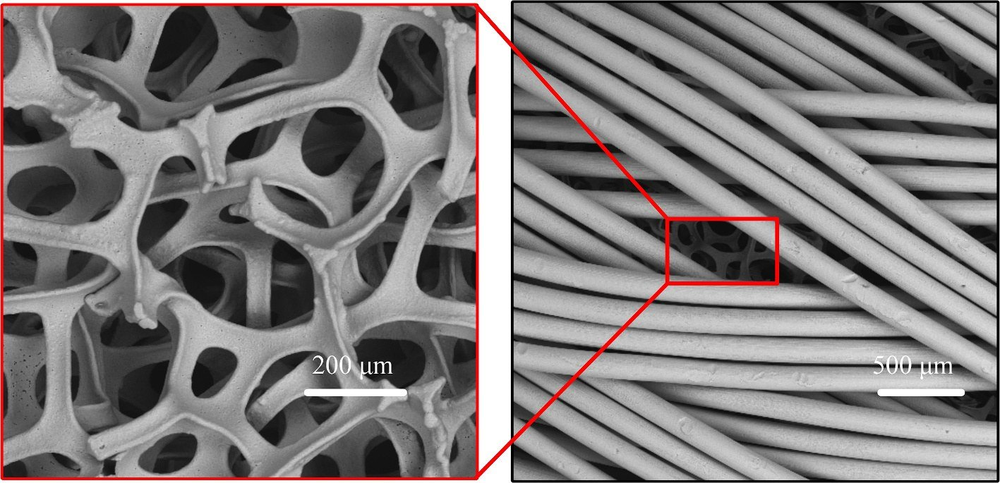
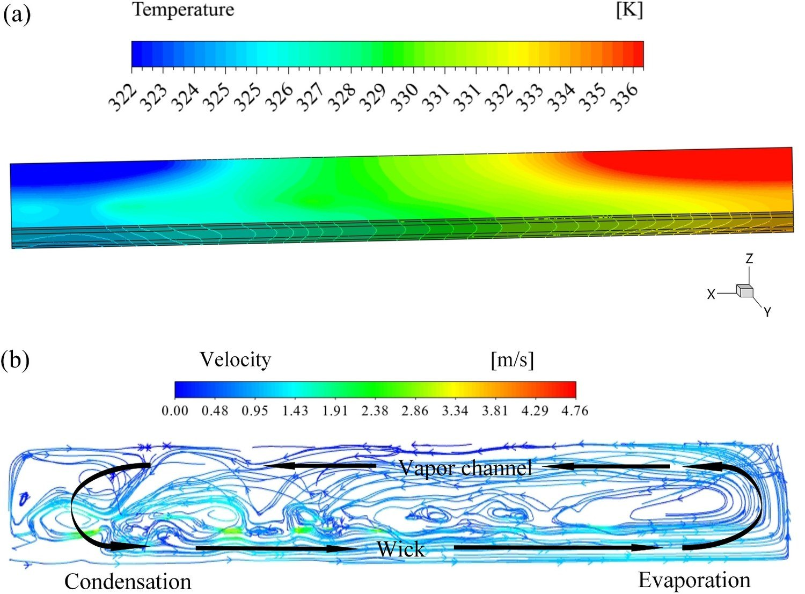

*Figure: Temperature field in the flat micro heat pipe and vapor-liquid phase distribution simulated by the VOF method*

## 4. Design of Downhole Electric Heating Equipment for Oil and Gas Resources

In situ extraction of oil shale from deep wells requires large volumes of nitrogen to be heated to high temperatures before being injected downhole, which imposes stringent requirements on the power density, pressure resistance and reliability of the heating equipment. In the absence of corresponding design standards, our group first defined a complete design procedure and specification for downhole tubular electric heaters, ranging from heat exchanger type selection and overall layout design to thermal design and optimization of the heater and structural strength design and verification. Part drawings of each component and three-dimensional assembly drawings were also produced, providing a reference and basis for the development of heater prototypes.

On this basis, a downhole fluid electric heater was developed. With a length within 10 m and a diameter of less than 300 mm, it can heat nitrogen at a flow rate of no less than 5 Nm³/min from room temperature to no less than 650 ℃ under a pressure of 10 MPa. A thermal design program was developed to determine the dimensions of the heating elements, and strength design and verification were carried out for structures such as the shell, support plates, threaded connections and flanges to determine the materials and structural dimensions of each part. A numerical model was then established to analyze the effects of structural parameters, such as the inner diameter and length of the heating tube, and operating parameters, such as flow rate and heating power, on the thermal performance of the heater. Field test results show that the convective heat transfer coefficient inside the heating tube exceeds 300 W/(m²·K), far higher than that of conduction heating and armored electric heaters. Without complex structures such as enhancement ribs, the outlet temperature of the heated fluid can reach approximately 900 ℃, and the comprehensive performance index is 40% higher than that of armored electric heaters with enhancement ribs. Moreover, the heating power and flow rate can be conveniently adjusted to meet different downhole heating requirements.

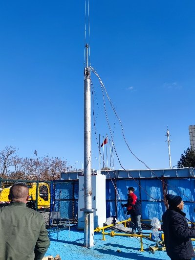
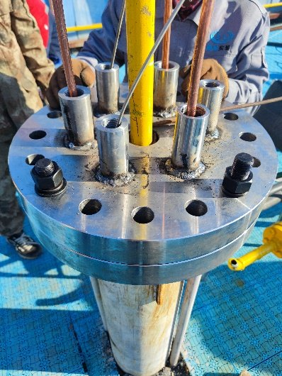
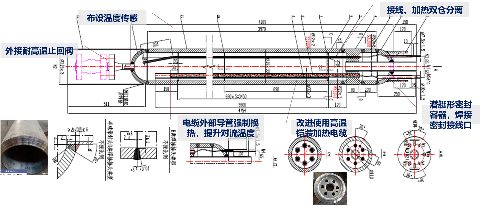
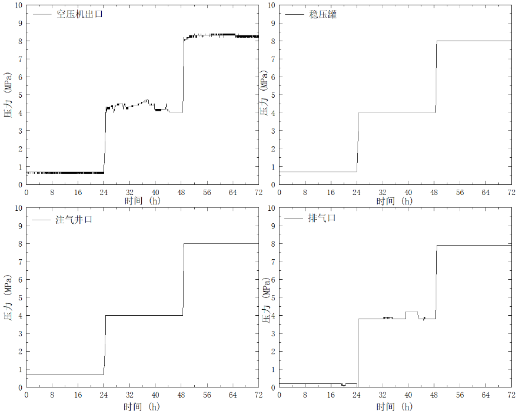
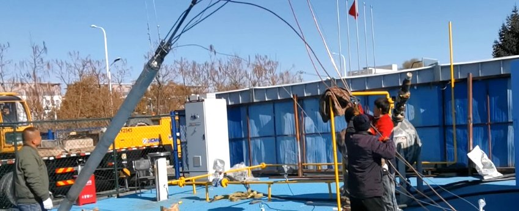

*Figure: Design and field testing of the downhole heater*

## 5. Engineering Application: Multiphysics-Coupled Thermal Management of Underwater Energy Storage Battery Compartments

For underwater energy storage systems, our group has carried out modeling, simulation and validation of electro-thermal coupling and liquid-cooling systems. A mechanistic model of cell heat generation was established based on the NTGK electro-thermal coupling model, with the model parameters determined by fitting discharge curves, and the temperature evolution of a single cell was simulated under multiple operating conditions, including 0.5C–1C discharge, 0.5P–1P charge/discharge and ambient temperatures of 5 ℃–35 ℃. The results show that the average temperature rise of the cell during 1C discharge is approximately 20 K, significantly higher than the approximately 4 K under 0.5C; heat generation during constant-power charging is lower than during discharging; and under adiabatic boundary conditions, the cell temperature exhibits a symmetric gradient distribution, higher at the center and lower at the top and bottom surfaces. This indicates that when the external heat dissipation paths are blocked, heat generation intensity becomes the dominant factor in temperature rise, and that properly constructing external heat transfer paths and reducing thermal resistance are key to suppressing temperature rise and the risk of thermal runaway.

At the module and battery compartment levels, a three-dimensional multiphysics-coupled thermal simulation model was established, comprising a solid battery domain, an air domain, a pipe fluid domain and a seawater domain. Mesh independence was verified (approximately 2.77 million cells in total for the battery compartment), and the model was validated experimentally: within 2500 s of 1P discharge, the deviation between simulation and experiment was less than 1 K. The study revealed how factors such as coolant flow direction, inlet velocity and temperature, seawater temperature, charge/discharge cycle and pump pressure affect the module temperature rise and temperature consistency. The flow resistance of the cold plate branches ranges from 7300 to 16400 Pa, and the flow distribution among the five parallel modules is non-uniform, with the flow rate in the branch closest to the water tank reaching about three times that in the branch farthest from it; extending the rest time reduces the maximum module temperature and improves the temperature uniformity among modules. Accordingly, the circulation pipeline layout and pump pressure configuration were optimized. After optimization, the maximum temperature difference among modules decreased from 1.4 K to 0.5 K, significantly improving battery temperature consistency; the energy efficiency ratio of the liquid-cooling system exceeds 4, and the maximum temperature difference within a module is approximately 2 ℃. These results provide a direct basis for the engineering design of thermal management systems for underwater energy storage.

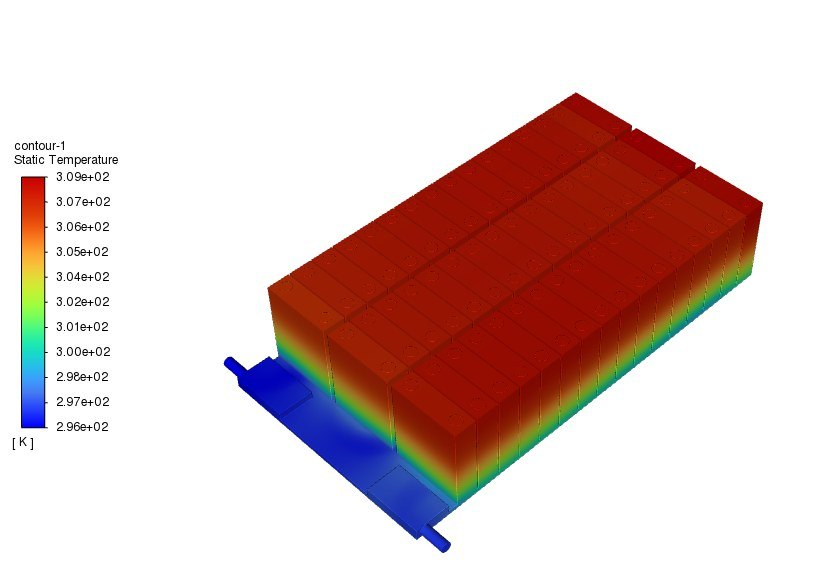
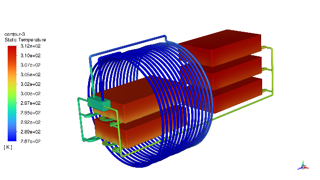

*Figure: Single-module liquid cold plate and temperature distribution in the battery compartment*
